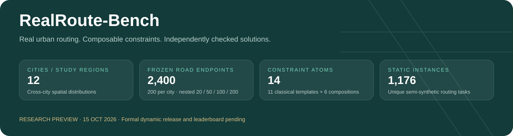
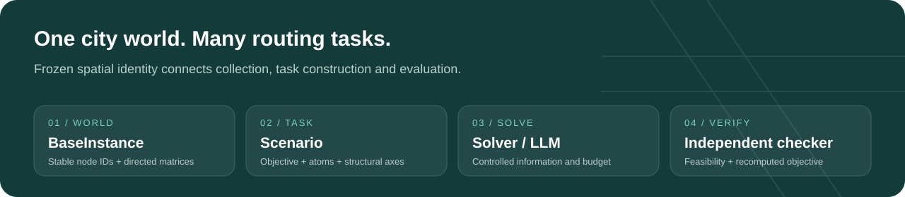
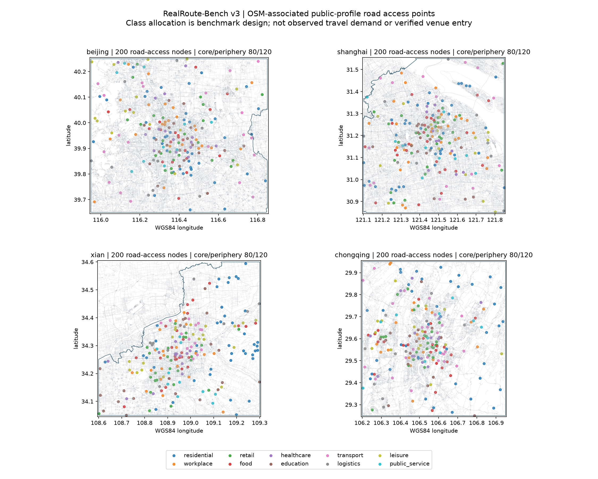
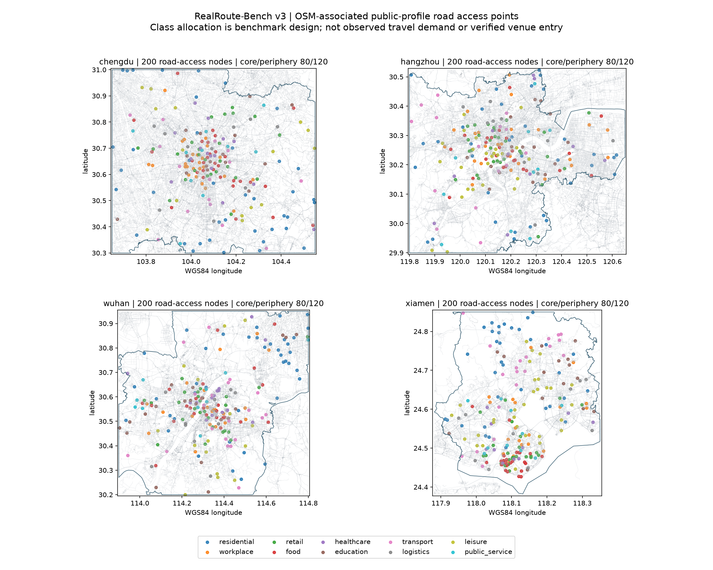
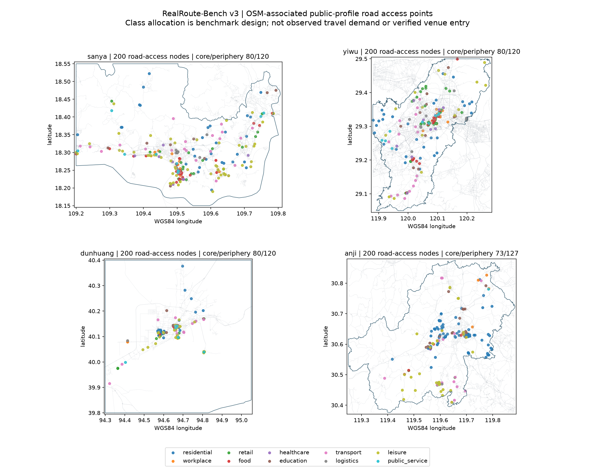

<p align="center"></p>

# RealRoute-Bench

**Can routing systems generalize across real cities, constraint compositions, and changing traffic?**

[简体中文](README.zh-CN.md) · [Status](docs/STATUS.md) · [Data card](docs/DATA_CARD.md) · [Evaluation](docs/EVALUATION.md) · [Repository scope](docs/REPOSITORY_SCOPE.md)

> **Research preview · 2026-10-19.** Collection and static-reference preparation are in progress. The complete dynamic release, formal LLM experiments and leaderboard are pending. This private repository is a curated artifact and progress snapshot, not a backup of the executable research workspace.

## One world, composable tasks

`BaseInstance + Scenario → Solver / LLM → Solution → independent checker`

A BaseInstance fixes node identity, order and directed matrices. A Scenario specifies objectives, vehicles, visit rules and constraint parameters. **Constraint configurations define the problem; classical names are templates.** The solver-independent checker reconstructs feasibility and objectives.



| Research axis | Available foundation | Remaining evidence |
| --- | --- | --- |
| Spatial generalization | 12 frozen city worlds; 1,176 static instances; city-held-out split | Full references and controlled solver comparisons |
| Composition generalization | Separate 1,512-case input set; all 14 atoms; interaction holdouts | Full composition references and formal model runs |
| Temporal information | Static / Reactive / Oracle on a common future snapshot; source-availability audit | Final sequence QA, date split and predictive-method experiments |

Demand, windows, service, prizes and fleets are **synthetic operational attributes**. OSRM durations are profile estimates; AMap durations are provider traffic-aware OD estimates. These are not observed delivery orders or vehicle-trajectory ground truth.

## Dated progress

Captured at `2026-10-19T06:11:10.976203+00:00` (UTC). The acquisition window is **15–28 October 2026**, China local time.

| Component | Current evidence |
| --- | --- |
| Recorded production slots | **540 / 1,680 (32.1%)**; per-frame quality status is retained in the machine-readable snapshot |
| Static-reference jobs | **2515 / 5,880** trusted terminal jobs; all jobs terminal for **484 / 1,176** tasks |
| Reference coverage so far | 183 tasks with EXACT references; 334 with BKS references; interim snapshot |
| Engineering verification | **431 tests, zero failures, 1 skipped**; not completion of formal experiments |
| Deterministic modeling control | 68 training conditions passed the semantic gate; two renderings checked for all 14 atoms; no new model calls |
| LLM preparation | 46 historical records replayed by layer; disabled balanced development designs of 12 or 48 calls |

**Quarantined and imputed frames do not count as complete REAL matrices.** Repeated seeds do not create independent instances. EXACT and BKS are separate, and interim results are not rankings.

[Progress evidence](evidence/PROGRESS_SNAPSHOT.json) · [Collection snapshot](downloads/COLLECTION_PROGRESS.json) · [City/day coverage](downloads/COLLECTION_COVERAGE.csv) · [Offline preparation](docs/OFFLINE_PREPARATION.md)

## Cities and nodes

Beijing, Shanghai, Xi'an, Chongqing, Chengdu, Hangzhou, Wuhan, the declared Xiamen study region, Sanya, Yiwu, Dunhuang and Anji. Each has a frozen Master-200 set and nested 20/50/100/200 subsets. The 2,400 nodes are **public-road access points associated with real OSM places**, not certified building entrances or final-access routes.

<details><summary>Frozen node maps for all 12 study regions</summary>





</details>

[Measured city structure](downloads/CITY_METRICS.csv). Sampling strata are research-design choices, not observed urban delivery-demand proportions.

## Data and verification

| Resource | Contents and limits |
| --- | --- |
| [Static inputs](downloads/static_public_v1.zip) | 1,176 base/scenario pairs, no private witnesses; parent N20/N50, with some physical N19/N49 pickup–delivery cases |
| [Static assignments](downloads/STATIC_SPLIT.json) | 588 train / 196 validation / 392 test; city-derived inputs stay together |
| [Frozen specification](docs/PROBLEM_SPEC_V1.md), [schemas](schemas/), [catalog](catalog/) | 14 atoms, four objectives, 11 classical templates and six original composition presets |
| [Historical pilot](downloads/PILOT_RESULTS.csv) | 17 Shanghai development cases, not the full reference run or a leaderboard |
| [Checksums](downloads/SHA256.json) | Download and snapshot integrity |

```sh
python3 scripts/verify_downloads.py
```

This command verifies the curated downloads only. Full executable source, raw provider responses, environments, operational ledgers and private reference answers are not shipped in this repository snapshot.

## Evaluation

- **Direct:** public constraints and matrices → route JSON → checker.
- **Model:** the same public input → declarative Scenario → semantic gate → fixed solver → checker.
- **Deterministic control:** the same controlled prompt → rule parser → the same gate and solver policy. This is not arbitrary natural-language understanding.
- **Temporal:** all modes choose routes under their declared information and are scored on the same designated future matrix. A heuristic Oracle is not a mathematical bound.

City and composition holdouts are separate experiments. Composition development shares city worlds and does not establish simultaneous unseen-city and unseen-composition generalization. Future traffic belongs only to Oracle and evaluation. Offline imputation may use later observations and is not causal forecasting input.

## Next milestones

1. Complete collection and QA; retain missingness and freeze date assignments.
2. Finish task-level EXACT / BKS / unavailable reference coverage.
3. Verify provider identity, tools, usage and balance before freezing a balanced LLM execution cohort.
4. Complete controlled experiments and a versioned release before publishing a paper or formal leaderboard.

[Website and storage plan](docs/HOSTING.md) · [Attribution and distribution boundaries](ATTRIBUTION.md). An author-approved paper citation is pending.
