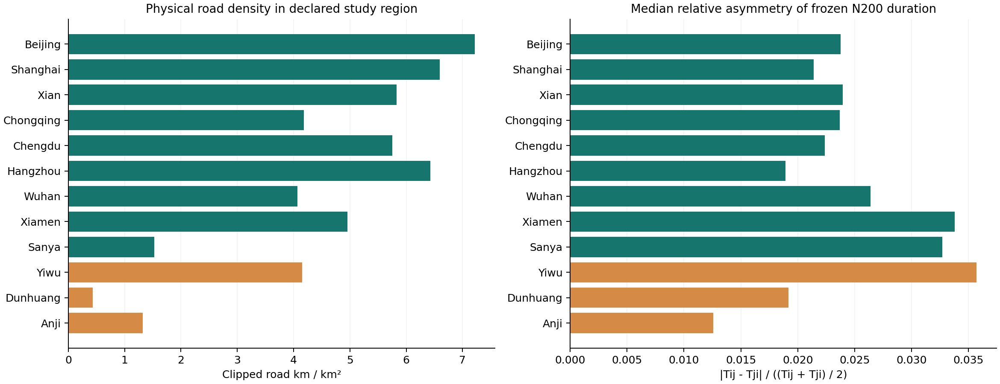

<p align="center"></p>

<h1 align="center">RealRoute-Bench</h1>
<p align="center"><b>Can routing systems generalize across real cities, constraint compositions, and changing traffic?</b></p>
<p align="center">
  <a href="#overview">Overview</a> ·
  <a href="#cities-and-frozen-nodes">Cities &amp; maps</a> ·
  <a href="#data-and-downloads">Data</a> ·
  <a href="#evaluation">Evaluation</a> ·
  <a href="docs/STATUS.md">Status</a> ·
  <a href="README.zh-CN.md">简体中文</a>
</p>

> **Research preview · snapshot: 17 October 2026.** This private repository is the current-stage project page and curated artifact snapshot. The OSM v3 spatial foundation and static task inputs are complete; the scheduled 14-day fresh traffic sequence is now **in progress** (day 3 of 14), while full reference runs and formal model evaluation are not yet a completed benchmark release. All results below are development pilots, not a leaderboard.

## Overview

RealRoute-Bench builds routing tasks on a shared, versioned urban world:

$$\mathcal W_c = (G_c, V_c, D_c^{\mathrm{OSM}}, T_c^{\mathrm{static}}, \{T_{c,t}^{\mathrm{dynamic}}\}).$$

Each task combines a **BaseInstance**—stable node identities and directed matrices—with a **Scenario** specifying objectives, vehicles, route endpoints and constraint atoms. A solver returns a structured solution; an independent checker reconstructs feasibility and the objective.

<p align="center"></p>

Three research axes organize the benchmark:

| Axis | Design | Current evidence |
|---|---|---|
| **Spatial generalization** | Heterogeneous city and county study regions; shared nested node scales | 12 frozen Master-200 sets; measured road structure; static city-held-out split |
| **Constraint composition** | 14 atoms, structural axes, four objectives | 11 classical templates, six composition presets, generator and checker; composition-held-out split pending |
| **Temporal information** | Compare decisions under static, currently available and future information | Future-snapshot pipeline implemented; formal dynamic results pending |

Demand, service times, windows, prizes and fleet parameters are **synthetic scenario attributes on real spatial data and modelled routing costs**. They are not observed delivery orders.

## Cities and frozen nodes

| Sampling group | Cities / study regions | Intended variation |
|---|---|---|
| Metropolitan | Beijing · Shanghai | Ring and core/periphery design hypotheses |
| Large urban | Xi'an · Chongqing · Chengdu · Hangzhou · Wuhan | Regular streets, terrain, water networks and river crossings |
| Coastal / tourism | Xiamen urban-and-peripheral study region · Sanya | Island/bridge structure and coastal tourism |
| County-level cities | **Yiwu · Dunhuang** | Commerce/logistics and low-density tourism |
| County study region | Anji | County core/periphery distribution |

These are sampling strata and research hypotheses, not official population rankings or certified traffic-demand labels. Xiamen explicitly denotes the declared study region, not the whole municipal administrative boundary.

Each city has **200 frozen public-road access points** associated with real OSM places and nested subsets $V_{20}\subset V_{50}\subset V_{100}\subset V_{200}$. Selection combines category quotas, source capacity, entity deduplication, 35 m separation, core/periphery balance and spatial coverage. OSM source-capacity limitations remain disclosed.

A node is a canonical point on a public road. It does **not** certify a physical facility entrance, vehicle access inside a campus, or the final access cost.

<details open>
<summary><b>Frozen node coverage · cities 1–4</b></summary>


</details>
<details>
<summary><b>Frozen node coverage · cities 5–8</b></summary>


</details>

<details>
<summary><b>Frozen node coverage · cities 9–12</b></summary>


</details>



Road metrics refer to declared study regions. Raw graph connectivity omits full turn restrictions and depends on graph representation; it does not certify operational routing connectivity. Frozen costs were computed with OSRM. [Metrics CSV](downloads/CITY_METRICS.csv)

## Data and downloads

| Layer | Source and semantics | Status / access |
|---|---|---|
| Spatial + static | OSM v3 endpoints; OSRM distance and profile duration | Complete locally; input-only static scenario bundle below |
| Fresh dynamic | AMap **provider traffic-aware OD duration**, same frozen endpoints | 14-day collection **in progress (day 3/14)**: 300/1,680 city-time frames collected as of 17 Oct 2026; final QA and release pending |
| Historical auxiliary | Chengdu native link-speed observations and derived native-graph diagnostics | 45 published days downloaded; 44 usable complete days; no validated full v3 mapping |
| Traffic context | Baidu published city metrics, curves and forecasts | Separate collection chain; nine covered cities; not OD ground truth |

The 1,176 unique static instances use parent scales N20 and N50. Some pickup–delivery cases have physical N19/N49 to preserve paired-customer parity. Master-200 does not mean every generated task currently has 200 nodes.

| Resource | Contents |
|---|---|
| [Static input bundle](downloads/static_public_v1.zip) | 1,176 `base_instance.json` + `scenario.json` pairs and assignments; no private witnesses |
| [Frozen static split](downloads/STATIC_SPLIT.json) | Train **588**, validation **196**, test **392**; city-grouped parent identity |
| [Problem specification](docs/PROBLEM_SPEC_V1.md) | Exact objective, constraint, output and validation semantics |
| [Schemas](schemas/) · [Catalog](catalog/) | Machine-readable contracts, atoms and presets |
| [Pilot results](downloads/PILOT_RESULTS.csv) | 68 traditional-solver development conditions |
| [Collection progress](downloads/COLLECTION_PROGRESS.json) · [coverage](downloads/COLLECTION_COVERAGE.csv) | Fresh dynamic collection status and per-city coverage snapshot |
| [Checksums](downloads/SHA256.json) · [Data card](docs/DATA_CARD.md) | Integrity, source distinctions and limitations |

**Download verification** (Python standard library only; no API calls):

```bash
python3 scripts/verify_downloads.py
```

The verifier checks file hashes, archive shape, all 1,176 task input pairs and city split counts. This repository is a curated project-page snapshot; collector credentials, raw traffic responses and the full executable research pipeline are not shipped here.

### Fresh Dynamic v1: collection design

**Collection window:** 15–28 October 2026 inclusive, `Asia/Shanghai`. Collection is **in progress** (day 3 of 14).

**Current progress** (snapshot: 17 October 2026):

| Metric | Value |
|---|---|
| City-time frames collected | **300 / 1,680** (17.9%) |
| OD-time values collected | 11,940,000 / 66,864,000 |
| Cities covered | 12 / 12 (25 frames each) |
| Provider quota used / remaining | 124,830 / 566,518 |

| Day | Frames collected |
|---|---|
| 15 Oct 2026 | 120 |
| 16 Oct 2026 | 120 |
| 17 Oct 2026 | 60 (in progress) |

Machine-readable snapshots: [collection progress](downloads/COLLECTION_PROGRESS.json) · [per-city coverage](downloads/COLLECTION_COVERAGE.csv).

```text
03:30  07:00  08:00  09:00  12:30
16:30  17:30  18:30  21:30  23:30
```

Target: **12 cities × 14 consecutive days × 10 slots = 1,680 city-time frames**, each with a 200×200 matrix and **39,800 non-diagonal directed OD entries**. Full completion would yield 66,864,000 OD-time values. Those entries are spatial observations within shared frames, not independent temporal samples.

The clock grid is an observation protocol, not a predefined peak label for every city. Cities are staggered by 0/5/10 minutes; each frame records its scheduled time, actual request/response times, acquisition duration, node hash and masks. A ≤5-minute per-city acquisition window is a quality target, not a measured guarantee. Missed frames remain missing; there is no retrospective substitute.

See [data card](docs/DATA_CARD.md) for availability timestamps, historical limitations and Baidu scope.

## Composable routing tasks

**14 atoms:** capacity, time windows, service time, route duration, distance limit, cost budget, prize, penalty, minimum prize, pickup–delivery, precedence, same vehicle, different vehicle, and vehicle limit.

**Structural axes:** single/multiple depots, homogeneous/heterogeneous fleets, required/optional visits, closed/open/fixed-end routes. These are separate from the atom count.

**Four objectives:** minimum total cost, minimum makespan, maximum prize, minimum cost plus penalty.

| Classical templates | Composition examples |
|---|---|
| ATSP · ACVRP · AVRPTW · ACVRPTW | Capacity + prize + open route + duration |
| AOP · PCTSP · AOVRP · AMDVRP | Multiple depots + windows + open route |
| APDP · APDPTW · AHCVRP | Pickup–delivery + prize + multiple depots |

Templates are convenient configurations. The complete Scenario determines task semantics; names do not override constraints. All six presets are in the [composition catalog](catalog/compositional_presets.json).

## Evaluation

### LLM tracks

| Track | Model output | Verification and tools |
|---|---|---|
| **Direct solution** | Route JSON from natural-language constraints and complete matrices | No external tools; independent checker |
| **Declarative modeling** | Structured Scenario JSON from the same public task description | Normalize and compare exact semantics; fixed solver; independent checker |

The modeling track currently does not execute arbitrary generated Python. Private witnesses, solver certificates and canonical task labels are excluded from model prompts. Tracks are reported separately with token, inference-time and solver-time budgets. Transport failures are separated from invalid model answers; follow-up retries never replace first-attempt records.

### Temporal information modes

| Mode | Information used to choose the route |
|---|---|
| **Static** | Earliest fully available frame of the same city/day |
| **Reactive** | Latest observation fully available at decision time |
| **Oracle** | Actual designated future target matrix |

Current future-snapshot tasks commit a route and evaluate the whole route on one fixed future target matrix. They do not switch traffic weights while the vehicle drives. Four one-hour pairs per day are planned: 07→08, 08→09, 16:30→17:30 and 17:30→18:30. If a target pair is missing, all modes exclude that pair consistently. Oracle gains are an empirical question; no predictive benefit is claimed yet.

**Scoring:** feasibility, violation diagnostics, checker-recomputed objective, runtime and resource usage. Report an optimality gap only against a certified optimum; otherwise report a gap to the best-known solution. Full protocol and remaining work: [evaluation](docs/EVALUATION.md).

## Development results

### Traditional solvers · Shanghai N20 parent scale

17 template/composition cases; MILP and LNS receive **5 seconds per case**. Pickup–delivery cases use physical N19. All returned solutions are independently checked.

| Method | Checker-valid cases / 17 | Notes |
|---|---:|---|
| Greedy baseline | 7 | Simple construction |
| Regret insertion + destroy/repair LNS | 17 | Heuristic; does not prove optimality |
| Gurobi, explicit restricted license | 13 | Four models exceed restricted-license size |
| HiGHS | 15 | Separate MILP backend |

The 17 references comprise **9 certified optima within numerical tolerance** and **8 BKS references**. This pilot is not evidence of superiority at N200 or over established external solvers. Full reference execution on 1,176 instances is pending. The configured full Gurobi license is expired.

### LLM pilots · separate cohorts

| Cohort | Condition records | Complete responses | Valid results |
|---|---:|---:|---:|
| Bailian first paired ATSP trial | 12 | 6 | 3 |
| Explicit transport recovery | 5 | 1 | 1 |
| Bailian capacity + time-window trial | 4 | 2 | 0 |
| Kimi K3 Anthropic follow-up | 2 | 1 | 1 |
| Intern independent-provider trial | 7 | 2 | 1 |

Recovery includes four pre-call budget blocks. Cohorts differ in protocol and recovery conditions; **do not pool them into model accuracy or a ranking**. Only two task families and single-trial development tests have been exercised. Repeated multi-city, multi-constraint formal experiments are pending. [Machine-readable summaries](evidence/LLM_COHORTS.json)

## Release status and roadmap

- [x] Problem definition, contracts, normalizer and independent checker.
- [x] 12-city OSM v3 node/static foundation; local graph reconstruction verified against frozen matrices.
- [x] 1,176 unique static inputs; static cross-city split; measured city metrics.
- [x] Solver adapters, LNS and actual LLM development trials.
- [x] Protected AMap scheduling, separate Baidu context collection, normalization and QA integration in the local research workspace.
- [ ] **In progress** — complete and QA the fresh sequence (day 3/14 collected as of 17 Oct 2026); freeze retained dynamic frames and date split.
- [ ] Freeze composition holdouts and formal model/budget/repetition protocols.
- [ ] Run full references, strong-baseline comparisons and formal LLM/temporal experiments.
- [ ] Publish a versioned benchmark release, paper and formal leaderboard.

Collector integration is implemented; this README is a dated snapshot, not a live uptime monitor. [Detailed status](docs/STATUS.md) · [repository scope](docs/REPOSITORY_SCOPE.md)

## Attribution and research context

OSM-derived data retain ODbL attribution and source-specific terms; this private snapshot does not grant blanket redistribution rights. Chengdu historical data, provider outputs and our authored documentation remain distinct. [Source attribution](ATTRIBUTION.md)

The project-page organization draws on [SWE-bench](https://www.swebench.com/original.html), [LiveCodeBench](https://github.com/LiveCodeBench/LiveCodeBench), [LiveBench](https://github.com/LiveBench/LiveBench), and [Inspect](https://github.com/UKGovernmentBEIS/inspect_ai). Routing/LLM research context includes [DRoC](https://github.com/Summer142857/DRoC) and the [FM4CO collection](https://github.com/ai4co/awesome-fm4co). We do not claim affiliation, paper acceptance or reproduction of their full experiments.

**Citation:** a formal paper and author-approved citation are pending. Please reference this repository and its commit when discussing this research preview.
